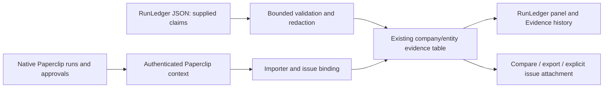

# Accountability implementation and engineering audit

Status: partial implementation, 2026-11-12. This increment delivers RunLedger
receipt correlation through the existing Verification and Evidence history
surfaces. It does **not** complete the proposed execution and browser platform.
No release is published and no protected branch is merged.

## Baseline and source authority

The starting plugin was `0.2.1`, commit `cde1b21`, with 21 generated tools,
38 discoverable Ability definitions and 15 bundled component snapshots. The
baseline verification command passed 44 files / 328 tests, with two platform
cases skipped. The manifest, worker, migrations and tests—not catalog entries—
determine executable support. The existing package includes approved Eval,
source execution, starter creation, offline Dispatch and project knowledge.

Research used the local Paperclip host at
`edc9bbbba12029a9f055d94d58c5a545bb2aaaba` and installed plugin SDK
`2026.1106.0`. The public [Kujo site](https://kujolang.ai),
[documentation](https://docs.kujolang.ai) and
[organization](https://github.com/kujolang) were checked for discovery; local
implementation takes precedence. The web reader could not retrieve the home
page; no branding claims or invented assets are used.

Host contracts:

- [SDK types](https://github.com/paperclipai/paperclip/blob/edc9bbbba12029a9f055d94d58c5a545bb2aaaba/packages/plugins/sdk/src/types.ts): issue parents, assignments, checkout/run identity, documents, interactions, jobs, database namespace, UI slots and orchestration summaries.
- [Host services](https://github.com/paperclipai/paperclip/blob/edc9bbbba12029a9f055d94d58c5a545bb2aaaba/server/src/services/plugin-host-services.ts): company-scoped access and capability enforcement. Orchestration summaries require `issues.orchestration.read`; this change does not request that additional privilege.
- [Plugin manifest](../src/manifest.ts), [workspace access](../src/paperclip/workspace.ts), [agent assignment check](../src/features/eval/bridge.ts): existing least-privilege boundary reused.
- [Compatibility evidence](COMPATIBILITY_SWEEP_2026_11_11.md) and [run-tab repair](RUN_TAB_RECOVERY_2026_11_12.md): official stable host does not mount the declared run tab. The separately tested host repair is not shipped by this increment.

Paperclip remains authoritative for organization, chain of command, issue
lifecycle, agent assignment, runs, logs, costs, approvals and audit events.
Plugin evidence supplements native execution history. No second task system,
agent hierarchy, execution scheduler or artifact service is introduced.

## Verified tool inventory

The definitions and strict inputs are generated from
[projections](../src/abilities/projections.json); handlers are registered by
[the worker](../src/worker.ts) and feature bridges. The complete existing inventory
remains 21 tools:

| Tools | Implementation / regression contract |
| --- | --- |
| `get-context`, `get-context-content` | Scent selection, two-stage content admission; `tests/plugin.spec.ts`, `tests/integration.spec.ts` |
| `review-changes`, `capture-failure` | ChangeBucket/PatchBrief, supplied CaseFile logs; `tests/plugin.spec.ts`, `tests/hardening.spec.ts` |
| `understand-repository` | Scout snapshot; `tests/integration.spec.ts` |
| `check-kujo-source`, `preview-kujo-format` | Source checks and non-writing format preview; `tests/language.spec.ts` |
| `inspect-kujo-packages` | Kennel declarations/lock inspection, no installation; `tests/packages.spec.ts` |
| `inspect-task-contract` | Spec validation, criteria remain not-run; `tests/spec-contracts.spec.ts` |
| `inspect-architecture`, `inspect-artifact-drift` | Fence/Concord bounded observations; `tests/fence.spec.ts`, `tests/concord.spec.ts` |
| `inspect-release-readiness` | ShipCheck metadata signals, not test execution; `tests/shipcheck.spec.ts` |
| `import-verification` | Canonical evaluation import, now optional RunLedger format and assigned issue scope; `tests/verification.spec.ts`, `tests/runledger.spec.ts` |
| `list-capabilities`, `list-evidence`, `get-evidence` | Profile readiness, scoped history/export; `tests/abilities.spec.ts`, `tests/history.spec.ts` |
| `manage-evaluation` | Human-confirmed bounded native Eval; `tests/eval-public.spec.ts`, `tests/eval-native.spec.ts` |
| `manage-kujo-execution` | Approved fixed source/test commands; `tests/source-execution.spec.ts` |
| `manage-kujo-starter` | Approved no-overwrite creation; `tests/starter-creation.spec.ts` |
| `manage-kujo-workflow` | Approved offline Dispatch via durable host job; `tests/workflows.spec.ts`, `tests/dispatch-native.spec.ts` |
| `manage-project-knowledge` | Explicit bounded local index/query; `tests/knowledge-public.spec.ts`, `tests/knowledge-native.spec.ts` |

Existing evaluation JSON calls remain valid without new arguments. No optional
producer is installed or executed by importing its receipt. Existing defaults,
company feature/profile gates and history permissions continue to apply.

## Capability matrix

“Available” means upstream implementation exists, not that this plugin invokes it.
“Deferred” identifies remaining engineering, not an unsupported host API.

| Capability | Paperclip support | Plugin before | Kujo source inspected | Enhancement / disposition | Priority |
| --- | --- | --- | --- | --- | --- |
| Agent hierarchy/delegation | Native agents, reportsTo, parent issues, checkout | Host-owned | PackWrite `src/validate.kujo` at `b846753` | Reuse host; retain parent issue and importing agent/run in receipts. Automated planning/delegation deferred | P0 |
| Receipt correlation | Native issue/run identity and DB namespaces | Persistent scoped evidence, no RunLedger import | RunLedger `src/record.kujo`, `src/cli.kujo` at `ab0ec5d` | Implemented bounded receipt import, comparison, export; provenance remains imported | P0 |
| Container execution | Plugins may run trusted processes; not inherently sandboxed | Host Eval/source execution, explicitly unsandboxed | Workcell `src/receipts/receipt.kujo`, `src/domain/definition.kujo` at `189d7ab` | Available upstream; adapter deferred. Local Docker daemon unavailable; no container qualification | P0 |
| Browser checks/artifacts | Host browser facilities are not a documented Lens execution contract | No Lens execution | Lens `src/runner.kujo`, `src/validate.kujo`, `src/flow_exec.kujo` at `9104964` | Available upstream; approved target/session/artifact adapter deferred | P1 |
| Release checks | Native completion is not external verification | ShipCheck metadata + approved Eval already implemented | Bundled ShipCheck/Eval lock and native tests | Reuse existing explicit classifications. No imported pass grants verified completion | P1 |
| Acceptance policy | Native issue permissions and interactions | No separate required/human-review policy engine | Spec native validation and Eval receipts | Advisory information only; required policy and waiver controls deferred | P1 |
| Planning/handoff | Native parent-child issues | Spec criteria inspection; no PackWrite import | PackWrite validation/summary, reviewed generation commands | Available, not integrated; preserve native `/agent` validator before adding import/generation | P1 |
| Workflow operations | Durable plugin jobs, confirmation cards | Offline Dispatch with retained ownership | Muzzle `src/runner.kujo` at `2d508d3` | Timeout/cancel-file upstream, trusted local code; approval-bound adapter deferred | P2 |
| Telemetry | Native run/cost records | Native receipts, no Watchdog collector | Watchdog `schemas/telemetry-trace-v1.schema.json` at `7a0bd9a` | RunLedger Watchdog IDs retained as unresolved correlation; routing/exporter integration deferred | P2 |
| Orchestration/retries | Native scheduler plus plugin jobs | Pinned offline Dispatch with exact checkpoint receipts | Dispatch source `18b5c73`, bundled pin separately retained | Reuse; no automatic retry of uncertain work or generic replay engine | P2 |
| Packages | Host plugin installation | Kennel read-only inspect | Kennel source `6e2fc20` | Existing implementation retained; no implicit installs | P2 |
| Failure evidence | Native run logs, issue documents | CaseFile bounded redacted supplied logs | CaseFile `92e1d9b` | Reuse; no duplicate logs store | P1 |
| Agent Black Box | Native run inspection | No adapter | README and source project at `7e2701d` | Demo/application, not required infrastructure; deferred | P2 |
| Verification Center | Detail/task extension slots; official run-tab limitation | Verification controls and Evidence history | Existing `src/ui/index.tsx` | Add RunLedger accountability panel to same surface; dedicated cross-issue dashboard deferred | P1 |

Upstream Workcell implements Docker/Podman resource and network policy,
container/workspace ownership cleanup and receipts. Temporary copied inputs in
the existing plugin are **not** Workcell containment. A future adapter must bind
image identity, reviewed definition, input commit, secret/environment allowlist,
network policy and resource budget to human approval, and reconcile interruption
before retry. It must never fall back silently to host commands. Remote backends
were not qualified.

Lens has real browser/spec/flow, link, accessibility and screenshot/report
interfaces; its runner performs URL/auth/artifact validation. Integrating it
requires approval for exact targets/actions, explicit authenticated-session
handling and bounded artifact retrieval. Browser instructions cannot change
policy. This increment executes no Lens workflow and retains no browser secrets.

## Evidence architecture

The new [adapter schema](../src/features/runledger/import.ts) is
`schemaVersion: 1`. It reads RunLedger's current unversioned record format; it
is not a new upstream RunLedger standard. It bounds input to 64 KiB UTF-8,
32 nesting levels and 1,000 tests/changed-file entries. Unsupported shapes,
invalid dates, reversed timestamps, unsafe token counts and invalid costs fail
explicitly before persistence. Missing optional metrics stay null, never zero.



Each immutable retained payload includes adapter version, import time, originating
tool, source-byte SHA-256, selected record fields, host company/project/issue,
parent issue, importing agent/run when supplied by the authenticated tool context,
validation method and explicit limitations. Source repository paths, prompt
paths, commands, arbitrary notes/extensions and raw logs are discarded. Selected
strings use the existing redactor. Correlation IDs are plain text, never fetched.
The record's provider/model describes a claim; host agent identity identifies
**the importer**, not authorship or independent verification.

Classification precedence: any claimed failed test or failed status is `failed`;
non-pass statuses, no tests or skipped tests are `incomplete`; remaining passes
are `unverified`. Contradictory pass/failed-test input remains a visible failed
claim. The adapter never claims to have observed a test execution. Neither a
checksum nor another agent's import authenticates the producer.

The existing SQL table stores kind `runledger-import`, source kind `imported`.
No new database or migration is needed because kind is text and source kind
already permits imported evidence. Existing IDs address retained observations;
RunLedger IDs remain external IDs inside them. Importing the same producer record
again creates a new observation, preserving revisions and earlier failures.
Comparisons include host attribution, start/end commits, changed files, tests,
manual usage, currency and correlation without synthesizing duration, totals or
success scores. Different currencies are never added together.

Persistence ownership, access and retention remain those of
[Evidence history](../src/storage/history.ts): 20 records per entity for 30 days,
immutable collision checks, payload digests, company/entity scope and explicit
clear. Retention is shared across kinds, so new imports can evict older records.
This is bounded operational history, not permanent archival storage. Export or
explicitly attach important evidence before pruning. Back up the Paperclip
plugin database namespace with the host database; original RunLedger files
remain producer-owned and must be backed up separately. Clear does not alter
native Paperclip history or the producer's ledger. Missing/pruned records remain
unavailable; import never reruns the producer to reconstruct them. If persistence
fails, the call fails; after an ambiguous response inspect history before retry.

## Access and lifecycle

Enable `features.verification`; Installed, Review, Ship or Full admits imports.
Build/Essentials do not. No local runtime or workspace is needed for imports.
Tools accept optional `issueId`, and verify current company, project, assignee
and checkout/execution run before issue writes. Host identity cannot be provided
through JSON arguments. Human RunLedger actions require authenticated user/company
context and readable entity access. Read/export/compare/attachment reuse existing
checks and feature/profile filtering. Receipts cannot overwrite earlier agents'
records. There is no policy-changing or waiver operation.

The import lifecycle is validate → redact → persist → audit. It creates no
background process. Existing approved execution remains governed by its durable
request/owner/cancel/uncertain states in [Execution](EXECUTION.md), not by an
imported receipt. No new approval bypass, execution policy or provider route is
introduced. A human import has no host run link; arbitrary historical-run lookup
is deliberately not inferred from producer text.

## Use and upgrade

Build/install the branch with the existing installation process, enable
Verification and open an issue or project. In **RunLedger accountability**, paste
one `runledger show RUN_ID --json` record. The panel shows classification, commits,
importer/run, parent issue and available metrics. Evidence history provides
inspection, comparison, export and human issue attachment.

Agent example (the issue must be assigned to the authenticated current run):

```json
{"format":"runledger","issueId":"HOST_ISSUE_ID","json":"<RunLedger JSON text>"}
```

Pass this to `kujolang.paperclip:import-verification`. Omit `issueId` for current
project scope. Omit `format` for the unchanged evaluation-result import contract.
Use `list-evidence` / `get-evidence` with `scope: "issue"` and the same issue ID.
The human panel binds the selected entity and cannot choose an arbitrary run.
Disable Verification to disable the imports and their evidence surfaces.
No runtime dependency, migration or mandatory ecosystem installation is added.

Troubleshooting: malformed/oversized JSON fails without retention; unavailable
records may have expired or been cleared; a stale assigned agent must use its
current host assignment/run; importing without the feature/profile is rejected.
A reported pass with no tests is incomplete. A failed supplied check wins over a
reported pass. Missing usage stays unknown. The official host's unavailable run
tab is a host limitation, not evidence loss.

## Demonstration and release boundary

[Demo instructions and artifacts](../examples/accountability-evidence/README.md)
distinguish real local producer checks, isolated unit/UI fixtures and live host
qualification. The host scenario uses actual agents, hierarchy, child issues,
checkout/run identity and authenticated imports. It imports retained native
producer output; it is not autonomous software delivery or Workcell/Lens execution.
The [test report](ACCOUNTABILITY_TESTS.md) records actual outcomes and limitations.

Accurate feature summary: “Correlate RunLedger attempts with Paperclip work,
compare supplied outcomes and available usage, and retain inspectable evidence
without treating an agent's reported pass as verified completion.”

Remaining scope: approved Workcell and Lens execution; PackWrite import/generation;
Muzzle lifecycle; direct Watchdog telemetry; required/human acceptance policies and
waivers; cross-issue evidence aggregation; permanent artifact retention; automatic
run-page navigation on the official host; and the complete autonomous multi-agent
software-delivery scenario. These are deferred, not claimed complete or supported
by mocks. There is no release-readiness or production-isolation certification.
