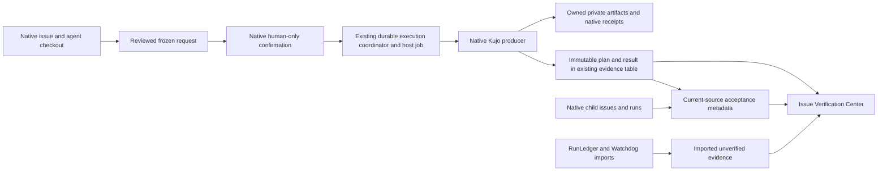

# Accountability implementation and engineering audit

Status: opt-in assurance integration, 2026-11-12. RunLedger correlation is now
joined by approved native Workcell, Lens, Muzzle and PackWrite execution,
acceptance metadata, delegated evidence and Watchdog metadata imports.
No release is published and no protected branch is merged.

## Baseline and source authority

The starting plugin was `0.2.1`, commit `cde1b21`, with 21 generated tools,
38 discoverable Ability definitions and 15 bundled component snapshots. The
baseline verification command passed 44 files / 328 tests, with two platform
cases skipped. The manifest, worker, migrations and tests—not catalog entries—
determine executable support. The existing package includes approved Eval,
source execution, starter creation, offline Dispatch and project knowledge.

Research used the local Paperclip host at
`edc9bbbba12029a9f055d94d58c5a545bb2aaaba` and installed plugin SDK
`2026.1106.0`. The public [Kujo site](https://kujolang.ai),
[documentation](https://docs.kujolang.ai) and
[organization](https://github.com/kujolang) were checked for discovery; local
implementation takes precedence. The web reader could not retrieve the home
page; no branding claims or invented assets are used.

Host contracts:

- [SDK types](https://github.com/paperclipai/paperclip/blob/edc9bbbba12029a9f055d94d58c5a545bb2aaaba/packages/plugins/sdk/src/types.ts): issue parents, assignments, checkout/run identity, documents, interactions, jobs, database namespace, UI slots and orchestration summaries.
- [Host services](https://github.com/paperclipai/paperclip/blob/edc9bbbba12029a9f055d94d58c5a545bb2aaaba/server/src/services/plugin-host-services.ts): company-scoped access and capability enforcement. Orchestration summaries require `issues.orchestration.read`; the delegation view requests that explicit additional privilege.
- [Plugin manifest](../src/manifest.ts), [workspace access](../src/paperclip/workspace.ts), [agent assignment check](../src/features/eval/bridge.ts): existing least-privilege boundary reused.
- [Compatibility evidence](COMPATIBILITY_SWEEP_2026_11_11.md) and [run-tab repair](RUN_TAB_RECOVERY_2026_11_12.md): official stable host does not mount the declared run tab. The separately tested host repair is not shipped by this increment.

Paperclip remains authoritative for organization, chain of command, issue
lifecycle, agent assignment, runs, logs, costs, approvals and audit events.
Plugin evidence supplements native execution history. No second task system,
agent hierarchy, execution scheduler or artifact service is introduced.

## Verified tool inventory

The definitions and strict inputs are generated from
[projections](../src/abilities/projections.json); handlers are registered by
[the worker](../src/worker.ts) and feature bridges. The complete existing inventory
preserves all 21 tools below and adds `manage-kujo-assurance`:

| Tools | Implementation / regression contract |
| --- | --- |
| `get-context`, `get-context-content` | Scent selection, two-stage content admission; `tests/plugin.spec.ts`, `tests/integration.spec.ts` |
| `review-changes`, `capture-failure` | ChangeBucket/PatchBrief, supplied CaseFile logs; `tests/plugin.spec.ts`, `tests/hardening.spec.ts` |
| `understand-repository` | Scout snapshot; `tests/integration.spec.ts` |
| `check-kujo-source`, `preview-kujo-format` | Source checks and non-writing format preview; `tests/language.spec.ts` |
| `inspect-kujo-packages` | Kennel declarations/lock inspection, no installation; `tests/packages.spec.ts` |
| `inspect-task-contract` | Spec validation, criteria remain not-run; `tests/spec-contracts.spec.ts` |
| `inspect-architecture`, `inspect-artifact-drift` | Fence/Concord bounded observations; `tests/fence.spec.ts`, `tests/concord.spec.ts` |
| `inspect-release-readiness` | ShipCheck metadata signals, not test execution; `tests/shipcheck.spec.ts` |
| `import-verification` | Canonical evaluation import, now optional RunLedger format and assigned issue scope; `tests/verification.spec.ts`, `tests/runledger.spec.ts` |
| `list-capabilities`, `list-evidence`, `get-evidence` | Profile readiness, scoped history/export; `tests/abilities.spec.ts`, `tests/history.spec.ts` |
| `manage-evaluation` | Human-confirmed bounded native Eval; `tests/eval-public.spec.ts`, `tests/eval-native.spec.ts` |
| `manage-kujo-execution` | Approved fixed source/test commands; `tests/source-execution.spec.ts` |
| `manage-kujo-starter` | Approved no-overwrite creation; `tests/starter-creation.spec.ts` |
| `manage-kujo-workflow` | Approved offline Dispatch via durable host job; `tests/workflows.spec.ts`, `tests/dispatch-native.spec.ts` |
| `manage-project-knowledge` | Explicit bounded local index/query; `tests/knowledge-public.spec.ts`, `tests/knowledge-native.spec.ts` |

Existing evaluation JSON calls remain valid without new arguments. No optional
producer is installed or executed by importing its receipt. Existing defaults,
company feature/profile gates and history permissions continue to apply.

## Capability matrix

| Capability | Native Paperclip / previous plugin | Current integration | Priority |
| --- | --- | --- | --- |
| Agent hierarchy | Native agents, reportsTo, parentId, checkout and runs | Read native orchestration; link child-owned evidence without a second hierarchy | P0 |
| RunLedger | Existing evidence namespace | Validated imported claims, issue/run importer correlation, attempt comparison, export, restart persistence | P0 |
| Workcell | Trusted plugin processes, no implicit sandbox | Approved local Docker definition; pinned image, offline container, bounded resources, disposable worktree, native receipts/artifacts, cancellation and scoped recovery | P0 |
| Lens | No previous native browser adapter | Approved loopback page checks or restricted executed flows; reports, accessibility/link checks for page mode, screenshots, intentional failure retained | P1 |
| ShipCheck/Eval | Existing metadata inspection and approved native Eval | Current-source acceptance policies consume retained native outcomes; imported claims cannot satisfy them | P1 |
| PackWrite | Native issues, existing Spec inspection | Validate existing agent/ packs or compile a supplied native manifest to a private reviewable pack; no provider invocation or automatic delegation | P1 |
| Muzzle | Native jobs and confirmation cards | Named reviewed workflow, retained full bounded logs, trusted host mode or Workcell containment | P2 |
| Watchdog | Native run/cost records | Optional kujo.telemetry.v1 metadata import, correlated importer identity, missing metrics remain unknown; no traffic proxy or prompt retention | P2 |
| Dispatch/Kennel/CaseFile | Existing offline orchestration, package inspection and supplied failure logs | Reused unchanged; no duplicate scheduler or package installer | P2 |
| Verification Center | Existing issue detail extension and evidence history | Approval preview, status/cancel/recovery, artifacts, acceptance and delegated evidence | P1 |
| Automatic handoff | Native issue.updated event and human interactions | Optional policy recomputation on in_review/done; never executes unapproved code from an event | P1 |

Exact component provenance is in [the checksum lock](../bundled/kujo-components.lock.json).
The original 15 components remain; four optional producer snapshots are added.
Workcell's scoped upstream patch `3a624b0` disables external Git diff/textconv
callbacks when collecting a binary patch. The plugin bundles that committed
source, not a private fork. Remote Workcell adapters are not bundled or invoked.

## Evidence architecture and trust

`assurance.run` extends the existing durable execution ledger. A request binds
company/issue, host requester/run, source head/fingerprint, admitted input bytes,
component/runtime digests, configuration, output limits and private storage.
Only the current native human-only confirmation authorizes that exact request.
Changes invalidate approval. The existing coordinator owns pending, preparing,
running, failed, succeeded, cancelled, stale and uncertain states. Queuing requires
an explicit start; a scheduled job only drains already-authorized queued requests.
There is no automatic retry. Restart reconciliation does not replay uncertain work.

Plans and outcomes use the existing SQL namespace and evidence parent links.
No new database is introduced. History has a shared **20 records per entity,
30-day** retention budget across kinds; export or explicitly attach valuable
records before pruning. Existing clear controls remove plugin evidence, not
native host runs. The execution ledger preserves durable request state separately.
Private workflow reservations retain input/output files for diagnosis and recovery;
these are operator-owned and have no automatic disk GC. Stop the plugin and back
up/export needed records before removing a terminal reservation administratively.
Never remove a reservation belonging to active work. Database backups must include
the plugin namespace; private-folder backups are separate. Native RunLedger files
remain producer-owned. Lost artifacts are unavailable, never fabricated by replay.

Artifact collection rejects symlinks, nonregular files, invalid UTF-8, more than
80 files, individual files over 1 MB or total bytes over 2 MB. Text is redacted;
PNG pixels cannot be reliably redacted, so Lens is limited to non-sensitive local
fixtures without saved authentication. Original-byte SHA-256 describes integrity,
not authenticity, and differs from redacted content. Evidence overflow produces
incomplete/uncertain results rather than silent success. Same-OS-user compromise
is outside this boundary; private copies do not isolate host commands.

RunLedger and Watchdog importers accept at most 64 KiB. Host identity is derived
from authenticated context, never supplied JSON. Importer identity does not prove
producer authorship. Watchdog strips prompts, responses, arguments and arbitrary
attributes. Neither import contributes a passing acceptance check. Unknown costs,
tokens, models and providers stay unknown; no synthetic totals or scores exist.

## Containment and browser limits

Workcell requires an explicit local Unix Docker endpoint and an already-present
immutable `sha256:` image ID. No pull/build, remote daemon, Podman, secrets, environment
injection, host mount, custom engine runtime or network access is admitted.
Limits are 2 CPUs, 1 GiB memory, 256 processes and 10 seconds of workload time.
The root filesystem is read-only, /tmp is ephemeral, and /workspace is a writable
disposable worktree of the bounded text snapshot. The source repository is not
mounted. Container isolation is not a VM or a guarantee against kernel compromise.
Recovery removes only exact private Workcell labels and native ownership-marked
workspaces; the original storage and endpoint binding must match. It never reruns
commands or changes the original outcome.

Muzzle defaults to explicitly reviewed **trusted host execution**. To contain it,
set selection.target to a reviewed Workcell JSON definition whose command is
`["sh", "/workspace/.muzzle/workflows/NAME.sh"]`. Workcell must also be enabled.
Only bash manifests are accepted for this route, without arguments. Native Muzzle
supervises a fixed wrapper around native Workcell; the original reviewed workflow
runs inside the container. Both sets of receipts/logs are retained. There is no
silent host fallback. Manifest name/script must select the exact displayed script.

Lens accepts HTTP loopback targets without credentials, query or fragment. Page
mode uses native quick checks, accessibility and bounded link checks. Native page
spec selectors other than main/body are not executed by the pinned producer; any
skipped assertion makes the plugin verdict incomplete. Use an executed flow for
CSS assertions and interactions. Flows must start with the reviewed URL, contain
an assertion, stay on the reviewed origin, and disable external/destructive options.
At most 12 steps, a 5-second per-step budget and one desktop viewport are admitted.
The overall coordinator deadline is 27 seconds. No saved sessions/auth are supplied.
Page content cannot change policy. These restrictions are not general browser
network sandboxing or proof that a user-labelled safe click has no side effects.

## Acceptance and native delegation

Configure one matching project policy (optionally scoped to an issue). Conflicting
policies produce unavailable. Checks select the latest native suite attempt, and
require a current source fingerprint and observed approved pass. Legacy outcomes
without a source binding cannot qualify. ShipCheck passes mean metadata readiness,
not execution of tests. PackWrite validation is `plan-valid`, never implementation.

Modes: advisory shows results; required withholds the separate verified-complete
metadata until checks pass; human-approval additionally requires a native human
review card bound to that exact evidence. Waivers require enabled policy, a reason
and a human-only decision; **waived is not passed**. Paperclip's native status and
permissions are never overridden. Agents cannot change policies or self-approve.
Checks may point to native descendant issue IDs in the same project/workspace.
The parent view reads their retained evidence; it does not copy ownership or trust
another agent's opinion as a test. Source fingerprinting covers Git-visible input,
not a running server's mutable external state; rerun checks when that state changes.

`observeHandoffs` evaluates existing evidence on native in_review/done events.
It does not grant execution authority. A human still approves/starts missing checks.
This is the supported alternative to automatic unreviewed repository execution.

## Configuration and use

See [the runnable demo](../examples/assurance/README.md) for complete configuration,
fixtures and commands. Enable only the adapters needed, and configure the existing
`workflow-state` private local-folder slot with read/write access. All are off by
default. Optional Lens dependencies are exact pinned Playwright Core and axe-core;
install its matching Chromium headless shell separately. `npm install --omit=optional`
keeps receipt imports available. It also omits optional platform runtime packages,
so execution then needs an explicitly configured or supported system Kujo binary. A Docker daemon is
needed only for Workcell and contained Muzzle. Unsupported platform/dependency
errors remain explicit; no privileged fallback occurs.

Use issue **Verification Center** to discover input names, inspect effects,
request native approval, resolve the issue card, queue and refresh. Inspect retained
artifacts without rerunning. Cancel active work or recover terminal owned resources.
Use acceptance review/waiver controls and delegated links to inspect child evidence.
Existing Evidence history provides export, comparison and explicit attachments.
Watchdog imports use the existing `import-verification` tool with format `watchdog`;
RunLedger uses format `runledger`. Existing evaluation imports remain unchanged.

Upgrade using the existing install/upgrade flow, explicitly acknowledging new
`issues.orchestration.read` and `events.subscribe` capabilities. No SQL migration is
required. Existing requests without the new source/endpoint bindings remain readable
but cannot become current acceptance or be silently rebound for recovery. Turning
features off prevents new execution; cancellation and bounded recovery remain available.

## Supported limits and distribution

The official host's declared run-tab mount remains a separately documented host
limitation; issue navigation and retained run IDs are the supported inspection path.
Remote sandbox backends, browser credential reuse, live Watchdog proxy routing,
provider-driven PackWrite generation and autonomous LLM staffing are not claimed.
The reproducible demo uses real deterministic process agents and native tools,
not mocked execution or fabricated token usage. Supplied PackWrite manifests can
be compiled and reviewed without provider credentials.

Feature summary: **Review approved container and browser checks from Paperclip
issues, inspect evidence across native delegated assignments, and distinguish
verified current work from submitted claims.** No release or protected merge is
part of this work. See [the verification report](ACCOUNTABILITY_TESTS.md) for actual
qualification results and remaining platform limits.
