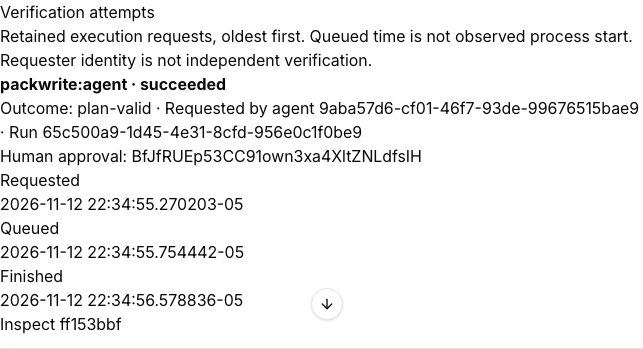

# Original assignment coverage review

Reviewed against the supplied “Kujo for Paperclip — Verification, Accountability &
Agent Workforce Integration” assignment, after bundle 0.13.1. This is a source and
execution-evidence review, not a claim of universal platform/provider support.
Historical receipts retain their original pins and outcomes.

| Assignment requirement | Implementation and evidence | Disposition |
| --- | --- | --- |
| Research, capability matrix, native reuse (§2, §21A) | [Engineering audit](ACCOUNTABILITY.md), manifest/worker, SDK 2026.1106.0 and authenticated host rehearsal | Implemented; preserves original 21 tools and adds one assurance tool |
| Canonical evidence, provenance and persistence (§3) | `src/execution/contracts.ts`, `src/storage/history.ts`, assurance history; native IDs, source snapshots, component/runtime digests, existing SQL namespace | Implemented; checksums are not producer authentication; retention and private-folder backup limits documented |
| RunLedger correlation/comparison/export (§4) | `src/features/runledger`, history UI; four native agent imports, restart assertions | Implemented; imported claims stay unverified; no fabricated usage |
| Optional bounded Workcell (§5) | `src/features/assurance/native.ts`, service/coordinator; native success, timeout, cancellation, artifacts, repeated scoped recovery | Implemented for local Docker; no remote adapter bundled; Podman executable absent in review environment |
| Lens verification and retained failure (§6) | Pinned native page/flow invocation, reports/screenshots, failed then corrected host flow | Implemented for unauthenticated loopback; main/body page assertions, other CSS via executed flows |
| ShipCheck/Eval and acceptance policies (§7) | `acceptance.ts`, native Eval, ShipCheck metadata; required/advisory/human review, stale evidence, missing checks and waiver tests | Implemented as separate verification metadata; no native issue-status override; ShipCheck is metadata readiness |
| PackWrite plans and handoffs (§8) | Native validation and supplied-manifest compilation, retained planning files, four-agent delegation | Implemented without provider calls; plans never authorize execution |
| Muzzle approved workflows (§9) | Named manifest/script binding, native logs, Workcell containment, host jobs | Implemented; this review adds explicit failure and running-cancellation evidence assertions |
| Watchdog correlation (§10) | `src/features/watchdog/import.ts`; host demo derives real request lifecycle timestamps and imports kujo.telemetry.v1 metadata | Implemented metadata projection; this is measured lifecycle metadata, not a Watchdog proxy/provider run; tokens/cost remain unavailable |
| Verification Center (§11) | Issue extension, screenshots/report explorer, acceptance, delegation and existing history comparison/export | Implemented; this review adds chronological attempts with recorded requester/run, human approval, timestamps and outcomes |
| Handoff verification (§12) | `issue.updated` observer recomputes existing evidence; approved queued work uses durable host jobs | Supported alternative: no implicit authorization or automatic replay; human approves and starts missing checks |
| Cross-agent accountability (§13) | Native reportsTo/parentId/checkout/run IDs, descendant scope checks, real four-process-agent rehearsal | Implemented; deterministic process agents, not LLM autonomy; opinion alone is not independent verification |
| Permissions/reliability (§14) | Human-only native cards, assigned-run checks, scoped storage, bounded subprocesses, stale bindings, interruption reconciliation | Regression tested within documented same-user threat boundary; no new permission bypass or generic command API |
| Modular optional dependencies (§15) | Disabled-by-default adapters, pinned source snapshots, optional Lens packages, imported evidence without execution | Implemented; no runtime code downloads; omission of optional runtime packages needs configured Kujo |
| Phases/demo/testing (§16–18) | [Verification history](ACCOUNTABILITY_TESTS.md), [demo](../examples/assurance/DEMO.md), acceptance scripts, unit/UI suites | Real packaged-host and native proofs; mocks confined to labeled fixtures |
| Documentation/distribution (§19–20) | README, usage/installation/accountability docs, architecture diagram, actual screenshots, native delegation diagram, structured demo evidence | Present; new walkthrough below; no publication or protected merge authorized |
| Deliverables/boundaries/definition of done (§21–24) | This matrix plus engineering audit, versioned contracts, tests, reproducible demo and refreshed review receipt | Supported scope reviewed; environment and host limitations remain explicit |

## Gaps closed by this review

The attempt list previously displayed only path/state, leaving attribution and
chronology in raw receipts. It now presents existing ledger observations oldest
first, including requester and run, recorded human approval, requested/queued/
finished times and classification. Queue time is explicitly not process-start
observation. An unavailable outcome is never inferred from state. No new history
store or fabricated assignment/delegation event is introduced. Cross-company
navigation discards delayed attempt responses, including at narrow widths.

Muzzle previously had passing execution and pre-start cancellation evidence, but
no direct retained-log assertion for a failed workflow or cancellation after an
actual output marker. The SDK/PGlite integration now executes both, confirms
failure versus incomplete cancellation, preserves artifacts and verifies earlier
failure records remain unchanged. The authenticated host demo also executes a
failed Muzzle workflow and inspects its retained log. Host UI acceptance now
checks the attempts view. Recovery previously returned a container-cleanup label
for non-container operations. The service now rejects those requests, and the UI
restricts recovery to Workcell and contained Muzzle. The host and SDK tests cover
this refusal while existing container recovery remains exercised. Failed host UI checks retain private screenshots for
diagnosis without relaxing assertions.

## Explicit boundaries

The official host run page still does not mount plugin tabs; the issue extension
and native run identifiers provide inspection. A separately tested host repair
exists but is not shipped by this plugin. This review does not deploy it.
Remote provider credentials, external authenticated browser sessions, proxy
rerouting, LLM-driven planning, other native architectures and releases are not
qualified by local tests. No production infrastructure is changed. Existing
retention is 20 records/entity for 30 days; private reservations are operator-owned
and require deliberate cleanup after preserving evidence. These constraints are
not silently promoted into completed support claims.

## Observed attempt presentation

This capture uses synthetic test identities from the real isolated host. It shows
a plan-validation outcome, not implementation success. See the
[final review receipt](verification/attachment-review-2026-11-12.json) for tests,
archive identity and earlier superseded runs.
