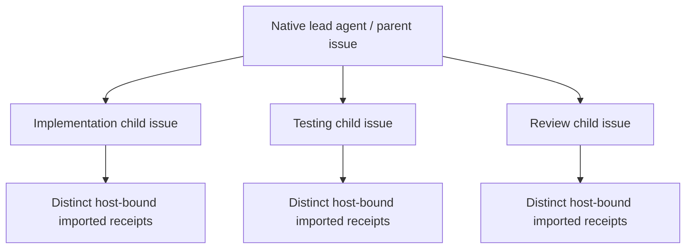

# RunLedger accountability demonstration

The two retained JSON files come from the actual RunLedger CLI and actual Node
assertions. `proof.json` includes exact assertion source, observed exits, producer
commit and output hashes. No Paperclip identity is fabricated: `local-demo-only`
is explicitly local, and host run/agent/issue fields are null.

The first attempt intentionally fails to filter a task list. The corrected
attempt filters matching tasks. Both remain inspectable. The corrected imported
receipt is **unverified**, because importing an operator-reported result does not
independently authenticate its execution.

Reproduce from the plugin root, using an inspected RunLedger source checkout and
Kujo binary:

```sh
node scripts/acceptance/runledger-demo.mjs /absolute/runledger /absolute/kujo /absolute/evidence-output
```

The script invokes fixed RunLedger commands, runs contained Node assertions in a
unique temporary directory, writes evidence to the explicit output and cleans its
temporary ledger. It needs no provider keys, container daemon or Paperclip server.
It does not test a browser UI or run untrusted project scripts.

## Actual host correlation scenario

Prepare the official Paperclip server `2026.1106.0` in an isolated npm prefix with
its supported runtime. The existing acceptance harness refuses an existing server
URL and creates a fresh private authenticated instance/database.

```sh
TMPDIR=/private/tmp KUJO_ACCEPTANCE_NPM_HOST=/absolute/isolated-host-prefix \
  KUJO_ACCEPTANCE_PRODUCTION=1 KUJO_ACCEPTANCE_PACK=accountability \
  node scripts/acceptance/execution-host.mjs
```

It creates a lead and three subordinate process agents, creates child issues,
uses native checkout and run IDs, imports the real local producer's failure and
correction under each authenticated agent context, rejects forged arguments,
cancels the disposable processes and revokes their keys, then restarts the host
and database to check all eight records. `accountability.json` holds real IDs;
`result.json` records checks and host identity. The retained `host-correlations.json`
and `host-result.json` contain the successful qualification; worker/manifest hashes
identify the modified working tree tested against the recorded base commit. Credentials are never exported.

This qualifies host correlation and retention, not autonomous delegation,
independent verification, browser automation or sandboxed execution. The process
agents are controlled integration participants; the harness submits imports using
their authenticated run contexts. Unit/UI mocks are separate tests and are never
represented as this live demonstration.


