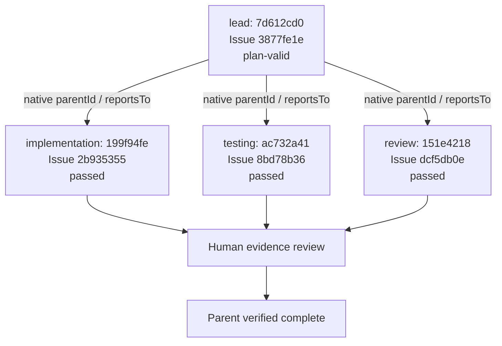
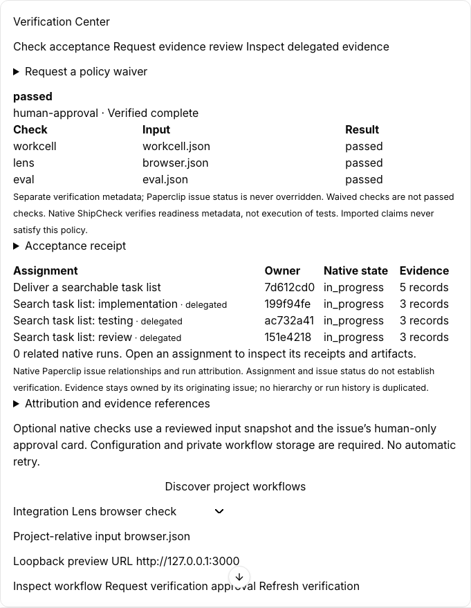
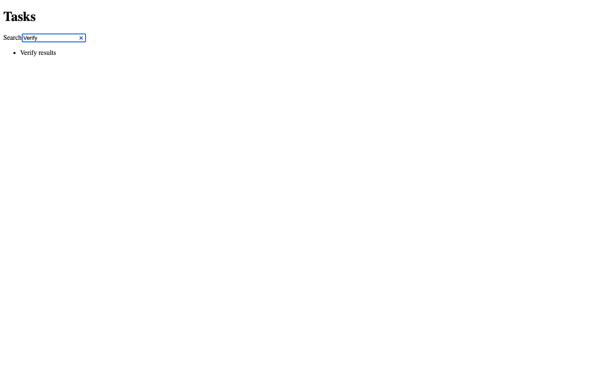

# Observed native delegation

This diagram uses the real host IDs in [team-proof.json](evidence/team-proof.json).
All four process runs succeeded. Each agent imported its own native RunLedger receipt.

The native issue state remains in_progress. Verified-complete is separate policy metadata, not an override of Paperclip status.
